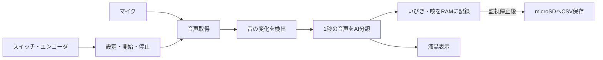

# Sleep Support — 睡眠中の音を記録する組込みシステム

睡眠中の**いびき・咳をマイコン上のAIで分類し、発生時刻とともに記録する**システムです。TRONプログラミングコンテスト2026向けに開発しています。

NUCLEO-H533REとリアルタイムOS **μT-Kernel 3.0** を使用し、音声の取得、イベント検出、AI推論、画面表示を並行して処理します。起床後に監視を停止すると、記録をmicroSDカードへCSV形式で保存できます。

## 紹介スライド・デモ動画

- [紹介スライド（Google スライド）](https://docs.google.com/presentation/d/1nfXK5-PnDkTTYysZEa5knIklS_sswlfNIqcd3jETNaQ/edit?usp=sharing)
- [デモ動画（YouTube）](https://youtu.be/x5j_fJoSZfU)

## 主な機能

- **装置内で音を分類**：マイクから取得した音を、いびき（SNORE）・咳（COUGH）・その他（OTHER）の3クラスに分類します。通常動作にインターネット接続は不要です。
- **音の変化に応じて推論**：周囲の音量を基準にイベントを検出し、その前後を含む1秒間をAIへ渡します。
- **音声波形を残さずイベントを保存**：通常動作では音声をRAMで一時的に扱い、CSVには時刻・種類・分類スコアを記録します。
- **本体で設定・操作**：液晶画面、スイッチ、ロータリーエンコーダで時刻、開始までの待ち時間、マイクゲインを設定できます。

## 使い方

1. [部品と配線](docs/hardware.md)を準備し、[ビルド・書き込み手順](docs/build.md)に従ってファームウェアを書き込みます。
2. 本体で現在時刻、開始までの待ち時間、マイクゲインを設定します。
3. SW1で開始します。待ち時間の終了後、自動的に音の監視を始めます。
4. 起床後にSW1で停止し、保存完了を待ちます。
5. 電源を切ってmicroSDカードを取り出し、PCで `EVT00001.CSV` などの記録を開きます。

詳しい画面操作と保存失敗時の手順は[利用ガイド](docs/usage.md)を参照してください。

## AI単体の分類性能

学習・モデル選択に使用していない、1秒音声 **1,162件** に対する静的テストの結果です。

| モデル | Accuracy（正解率） | Macro-F1 |
|---|---:|---:|
| float32モデル | 95.01% | 0.9234 |
| **実機採用のINT8モデル** | **94.92%** | **0.9225** |

評価条件、クラス別の適合率・再現率・F1、混同行列は[AIの仕組みと評価](docs/ai.md)、使用データの出典と分割方法は[学習データセット](docs/datasets.md)にまとめています。この数値は、切り出した音声の分類性能を示します。

## 詳細ドキュメント

| 資料 | 内容 |
|---|---|
| [システム概要](docs/overview.md) | 目的、構成、処理の流れ、記録の範囲 |
| [ハードウェア・部品・配線](docs/hardware.md) | 使用部品、電源、マイク・LCD・microSDなどの接続 |
| [利用ガイド](docs/usage.md) | 設定、監視開始・停止、CSVの確認、保存再試行 |
| [ビルドと書き込み](docs/build.md) | 開発環境、プロジェクトの取り込み、通常動作の設定 |
| [RTOSと処理構成](docs/architecture.md) | タスク、優先度、通知、バッファ、検出アルゴリズム |
| [AIの仕組みと評価](docs/ai.md) | 前処理、CNN、量子化、静的テスト結果 |
| [学習データセット](docs/datasets.md) | 出典、利用条件、クリップ生成、データ分割 |
| [音声の取り扱いと保存形式](docs/data-handling.md) | 音声の一時処理、CSV仕様、時刻、保存上限 |

## ソフトウェア構成

| ディレクトリ | 内容 |
|---|---|
| `Application/` | 音声取得、検出、推論の制御、入力、表示、保存 |
| `Core/` | STM32の初期化、AI前処理・推論インタフェース |
| `AI/` | 学習・評価用コード、Notebook、モデル、生成済みパラメータ |
| `AI_Model/` | ST Edge AIによる生成モデルコード |
| `mtk3_bsp2/` | μT-Kernel 3.0とボード対応コード |
| `Drivers/`・`Middlewares/` | 周辺機器ドライバ、CMSIS、AIランタイム |
| `docs/` | 公開用の詳細ドキュメント |

## 使用ソフトウェア・データの出典

μT-Kernel 3.0 BSP2、STM32 HAL、CMSIS-DSP、ST Edge AI、FatFsを利用しています。各コンポーネントの著作権・利用条件は、それぞれの配布物に従います。

学習にはESC-50、Coswara、AudioSet Strongを使用しています。音声とアノテーションの利用条件は同一ではありません。出典と本プロジェクトでの加工内容は[学習データセット](docs/datasets.md)に記載しています。

## 開発メンバー

本プロジェクトは、以下のメンバーによる共同開発です。

| メンバー | 主な担当 |
|---|---|
| https://github.com/ToMirin | AI・音声処理 |
| https://github.com/Hiroaki-SONODA | システム設計・回路 |