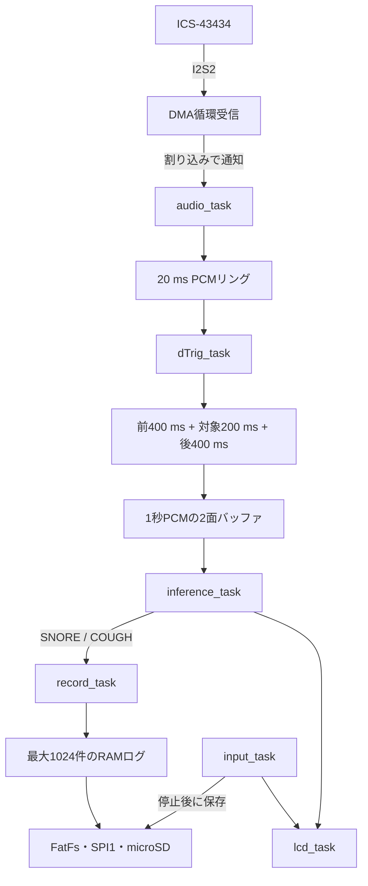

# RTOSと処理構成

[READMEに戻る](../README.md)

## μT-Kernelを使う構成

本システムでは、リアルタイムOS（RTOS）であるμT-Kernel 3.0のタスク、イベントフラグ、ミューテックスを使い、音声の連続取得と推論・操作・表示を分担します。ボードへの対応にはμT-Kernel 3.0 BSP2を使用します。

アプリケーション起動時に検知、入力、推論、記録、LCDの5タスクを生成し、音声モジュールが別途1タスクを生成します。通常動作のアプリケーションタスクは計6本です。音声タスクを生成した時点ではDMA受信を開始せず、利用者の開始操作と待ち時間の終了後に受信を始めます。

## タスクと優先度

優先度の数値は小さいほど高くなります。表のスタック容量は現在のソース設定値で、使用量の測定値ではありません。

| タスク | 優先度 | スタック | 役割 |
|---|---:|---:|---|
| `audio_task` | 5 | 2,048 B | DMA受信面の処理、ゲイン調整、PCMリングへの格納 |
| `dTrig_task` | 8 | 2,048 B | RMSによる検出、1秒音声の組み立て |
| `input_task` | 10 | 4,096 B | スイッチ・エンコーダ、画面遷移、開始・停止、SD保存 |
| `inference_task` | 12 | 2,048 B | AI前処理と推論、結果通知 |
| `record_task` | 16 | 1,024 B | イベント情報をRAMへ蓄積 |
| `lcd_task` | 18 | 2,048 B | LCDへの表示反映 |

音声取得と検知を推論より高い優先度に設定しています。スイッチは10 ms周期で読み取り、3回連続で一致した状態を確定します。エンコーダはTIM8でA/B相を計数し、4カウントを1操作へ変換します。

## データの流れ



### 音声取得

I2S2で受信した24 bit音声の左チャンネルを取り出し、デジタルゲインを適用して符号付き16 bit PCMへ変換します。16 bitの範囲を超えた値は飽和させます。

1ブロックは320サンプル、16 kHzで20 msです。PCMリングは100ブロック分の領域を持ちます。割り込み内では推論を行わず、受信完了通知を音声タスクへ渡します。

### 検出と1秒入力の生成

連続した10ブロックを200 msの単位にまとめ、RMS（二乗平均平方根）で振幅の大きさを求めます。

| 項目 | 現設定 |
|---|---|
| 初期化 | 最初の10単位（有効音声2秒）のRMS中央値を背景音レベルに使用 |
| トリガー閾値 | 背景音レベルの2.0倍 |
| 解除閾値 | 背景音レベルの1.5倍 |
| 検出状態の解除 | 解除閾値未満が2単位（400 ms）連続 |
| 背景音レベルの追従 | 待機中の非トリガー区間で指数移動平均、係数0.2 |

検出中は重複した自動トリガーを抑えます。トリガー前400 ms、対象200 ms、後400 msを連結し、16,000サンプルが揃ったときに推論要求を送ります。

DMAブロックの通番が途切れた場合、欠落の前後を連結せず、作成途中の入力を破棄します。必要な長さを確保できない場合にゼロ埋めで補うことはありません。

### 推論バッファと所有権

推論入力は1秒PCMを2面用意し、各面を次の状態で管理します。

```text
FREE → WRITING → READY → INFERENCE → FREE
```

検知タスクが空き面へコピーし、準備完了をイベントフラグで通知します。推論中の面を検知タスクが上書きすることはありません。両面とも使用中の場合、新しい要求は破棄します。

`ai_pipeline_predict()` は1本の推論タスクから同期的に呼び出します。この関数は同時呼び出しに対応せず、実行中だけ入力PCMを参照します。AI処理に失敗した入力は記録せず、バッファを解放します。

### 表示と記録の通知

LCDへの要求はミューテックスで直列化し、イベントフラグで表示タスクへ通知します。呼び出し側は表示反映の完了通知を待ちます。

推論結果のうちSNORE・COUGHを記録タスクへ通知します。記録通知には1件分の受け渡し領域があり、未処理通知が残っていると新しい通知を受け付けられません。RAM保存上限とは別の制約です。

推論タスクはSNORE・COUGHの結果表示後に2秒待機します。この表示待ちもあるため、AI関数の計算時間だけから連続イベントの処理間隔を見積もることはできません。

## 停止と保存

停止操作時にSTOP時刻を確定し、音声取得の停止を要求します。入力タスクはGood Morningを表示し、音声停止・推論・RAM記録の完了を待ってから保存を行います。停止直前に取得した入力の推論結果も、完了待ちの中で記録対象になります。

microSDへのファイル操作は入力タスクだけが実行し、監視中には書き込みません。保存先の番号を確保し、一時ファイルへ全件を書き込み、ファイルを閉じてからCSVへ改名します。保存失敗時は同じセッションのRAM記録を保持し、利用者の操作で再試行します。

## 実装の入口

| 実装 | 読みどころ |
|---|---|
| [sleep_app.c](../Application/sleep_app.c) | タスクと同期オブジェクトの生成 |
| [sleep_app_config.h](../Application/sleep_app_config.h) | 優先度、待機時間、設定範囲 |
| [audio.c](../Application/audio/audio.c) | DMA、PCM変換、リング管理 |
| [detection.c](../Application/detection/detection.c) | 検出状態、入力窓の組み立て |
| [inference.c](../Application/inference/inference.c) | 2面バッファ、AI呼び出し、結果通知 |
| [input.c](../Application/input/input.c) | 操作とセッションの進行 |
| [storage.c](../Application/storage/storage.c) | RAMログ、時刻変換、CSV保存 |
| [lcd.c](../Application/lcd/lcd.c) | 表示要求と画面更新 |

モデル自体は[AIの仕組みと評価](ai.md)、ファイル仕様は[音声の取り扱いと保存形式](data-handling.md)に記載しています。
