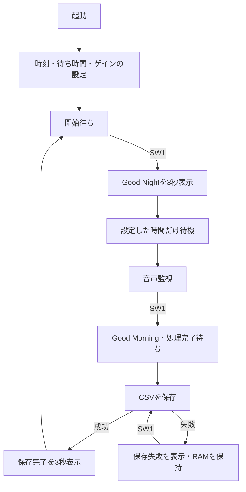

# システム概要

[READMEに戻る](../README.md)

## 目的

Sleep Supportは、睡眠中に発生したいびきや咳を、あとから時刻とともに振り返るための音響イベント記録システムです。マイクで音を取得し、マイコン内のAIで分類します。利用者は本体で監視を開始・停止し、microSDカードに保存されたCSVをPCで確認できます。

記録対象は音響イベントです。睡眠段階、睡眠時間の自動判定、病気の診断を行う機能はありません。

## 装置の構成

| 構成要素 | 役割 |
|---|---|
| NUCLEO-H533RE | 音声取得から推論・記録までを実行 |
| ICS-43434マイク | 周囲の音をデジタル信号として入力 |
| 16文字×2行のI2C液晶 | 設定、監視状態、検出結果、保存結果を表示 |
| スイッチ・ロータリーエンコーダ | 設定値の変更、決定、開始・停止 |
| microSDカード | 停止後のイベント記録を保存 |
| μT-Kernel 3.0 | 各処理をタスクに分け、優先度に従って実行 |

通常動作は装置内で完結し、クラウドへの音声送信やネットワーク経由の推論を行いません。

## 音声から記録まで

1. **取得**：マイクから16 kHzの音声を取得し、20 msごとのPCM（音声波形の数値列）に変換します。
2. **検出**：200 msごとにRMS（音の振幅の大きさ）を計算し、周囲の音量に応じた閾値と比較します。
3. **切り出し**：検出した200 msの前後400 msずつを合わせ、1秒の音声を作ります。
4. **分類**：Log-Mel特徴量へ変換し、小型CNN（畳み込みニューラルネットワーク）でOTHER・SNORE・COUGHに分類します。
5. **記録**：SNOREとCOUGHの時刻・種類・分類スコアをRAMに蓄積します。
6. **保存**：利用者の停止操作後に処理の完了を待ち、microSDへまとめてCSVを書き込みます。

音声を取り込み続ける処理と、必要なときに行う推論を分離しています。また、microSDへの書き込みは監視停止後に行います。詳しいタスク構成は[RTOSと処理構成](architecture.md)を参照してください。

## 設定から保存まで

## 記録を読むときの前提

- OTHERは保存しません。CSVに記録がない時間が、必ずしも無音だったことを意味するわけではありません。
- 同じ音が続く間は重複トリガーを抑制します。記録件数は、個々の咳やいびきの回数と必ずしも一致しません。
- 時刻は本体に設定した時分と経過時間から求めます。CSVには日付や秒を含みません。
- RAMに保持できる音響イベントは1セッション最大1,024件です。電源を切る前に保存を完了させてください。

[利用ガイド](usage.md)では操作を、[音声の取り扱いと保存形式](data-handling.md)では記録の内容と制約を説明しています。
